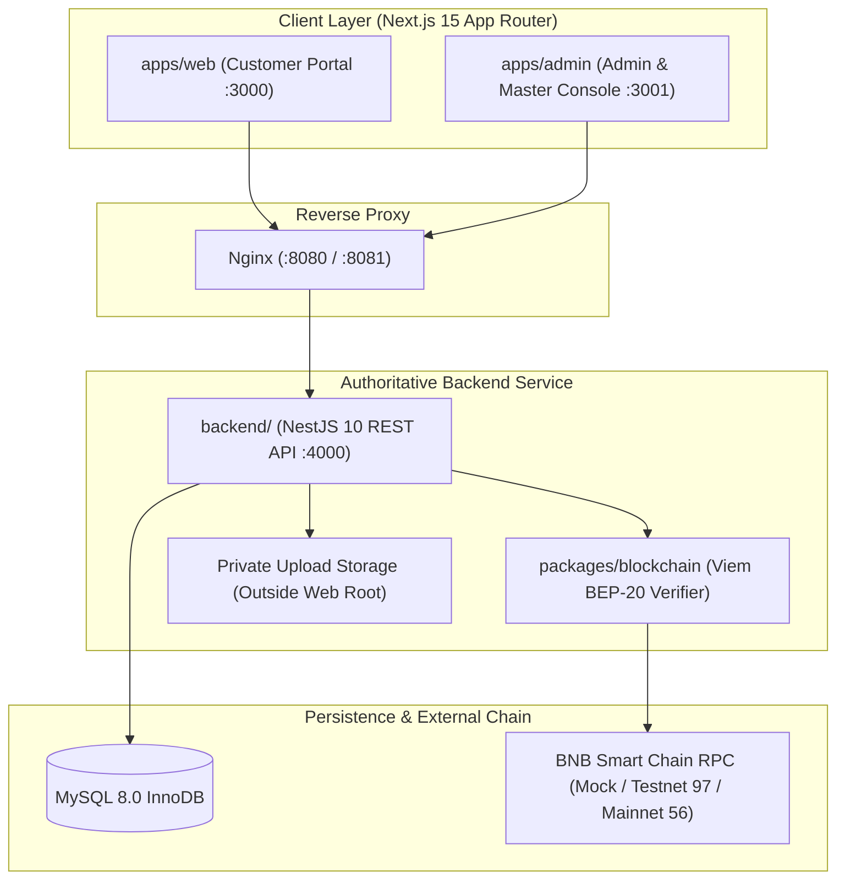

# NAVRIX System Architecture

## 1. High-Level Topology

NAVRIX separates customer-facing experiences, privileged operations/governance consoles, authoritative backend financial logic, blockchain RPC verification, and MySQL ACID persistence into strictly bounded layers.

---

## 2. Monorepo Package Boundaries

| Workspace | Package Name | Responsibility |
| :--- | :--- | :--- |
| `apps/web` | `@navrix/web` | Customer website & authenticated financial dashboard. Every route uses a dedicated `page.tsx` paired with a dedicated `<page>.module.css` stylesheet. |
| `apps/admin` | `@navrix/admin` | Operations & Master Admin console. Every route uses a dedicated `page.tsx` paired with a dedicated `<page>.module.css` stylesheet. |
| `backend` | `@navrix/backend` | Dedicated NestJS REST service enforcing JWT + rotating refresh cookies, RBAC (`USER`, `ADMIN`, `SUPER_ADMIN`, `MASTER_ADMIN`), state machines, double-entry ledger, and immutable audit logging. |
| `packages/database` | `@navrix/database` | Prisma ORM configured **exclusively for MySQL 8.0** (`provider = "mysql"`), migrations, atomic `nextReadableUid` generator, and development seeding. |
| `packages/blockchain` | `@navrix/blockchain` | `viem`-based BNB Smart Chain client, ERC-20 `Transfer` log parser, confirmation calculator, and 9-step `DepositVerificationService`. |
| `packages/types` | `@navrix/types` | Canonical enums, `DEPOSIT_STATE_TRANSITIONS`, `WITHDRAWAL_STATE_TRANSITIONS`, role rank helpers, and API response envelopes. |
| `packages/validation` | `@navrix/validation` | Shared Zod schemas used on both client forms and backend validators (`bscTxHashSchema`, `evmAddressSchema`, `passwordPolicySchema`). |
| `packages/ui` | `@navrix/ui` | Shared accessible React UI primitives (`Button`, `Card`, `StatusBadge`, `EmptyState`, `CopyButton`, `formatUsdt`, `shortenHex`). |
| `packages/config` | `@navrix/config` | Shared TypeScript compiler presets, brand metadata, default public BEP-20 receiving wallet (`0x98386622d3937c0A3582E07aEc06041C3fb7b521`), and compliance disclosures. |

---

## 3. Core Architectural Invariants

1. **Zero Private Key Custody in Software:** The platform stores **only public receiving addresses** (`0x98386622d3937c0A3582E07aEc06041C3fb7b521` by default). Outbound withdrawals are executed externally by treasury operators (e.g., hardware wallet or multisig) and finalized by recording the verified 66-character outbound BSC transaction hash.
2. **Blockchain Receipt is the Single Source of Truth:** Screenshots, user-entered amounts, and user-submitted sender addresses are treated purely as unverified hints. Only on-chain ERC-20 `Transfer` logs matching the configured USDT token contract and receiving wallet address can authorize an approval.
3. **Immutable Double-Entry Ledger:** User wallet balances are never arbitrarily overwritten. Every balance-changing event (`DEPOSIT`, `INTEREST`, `WITHDRAWAL`, `WITHDRAWAL_REVERSAL`, `ADJUSTMENT`, `FEE`, `REFUND`) writes an append-only `LedgerEntry` with `balanceBefore`, `balanceAfter`, and a unique `idempotencyKey` inside a row-locked (`SELECT ... FOR UPDATE`) MySQL transaction.
4. **Continuous Solvency Reconciliation:** `LedgerService.reconcilePlatformLedger()` continuously verifies across all MySQL wallet buckets that:
   $$\sum (\text{availableBalance} + \text{lockedBalance} + \text{investedBalance}) \equiv \sum \text{Ledger Credits} - \sum \text{Ledger Debits}$$
   with zero discrepancy (`0.00000000 USDT`), surfaced live in the **Master Admin Command Center** (`/master`).

