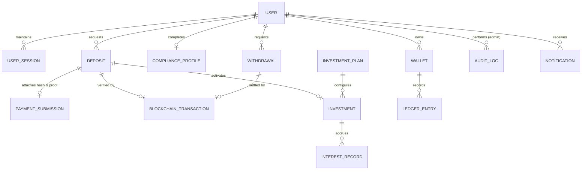

# MySQL Database Schema & Financial Constraints

NAVRIX uses **MySQL 8.0 (InnoDB)** exclusively (`provider = "mysql"` in `packages/database/prisma/schema.prisma`). No secondary database or external key-value store is required.

## 1. Entity-Relationship Overview



---

## 2. Core Tables (18 MySQL Product Tables)

| Table Name | Primary Purpose | Key Unique / Integrity Constraints |
| :--- | :--- | :--- |
| `uid_sequences` | Atomic readable ID counters | `UNIQUE(prefix)` (`USR`, `DEP-YYYYMMDD`, `INV-YYYYMMDD`, `WDR-YYYYMMDD`, `LED-YYYYMMDD`, `INT-YYYYMMDD`) |
| `users` | Customer & staff accounts | `UNIQUE(publicUid)`, `UNIQUE(email)`, `UNIQUE(googleId)`; sequential DB primary keys are UUIDs and never exposed |
| `user_sessions` | Refresh-token rotation families | `UNIQUE(refreshTokenHash)`, indexed by `familyId` for instant replay revocation |
| `auth_tokens` | Email verification & password reset | `UNIQUE(tokenHash)` (SHA-256 hashed tokens with expiry & `usedAt`) |
| `compliance_profiles` | Configurable KYC/tax & legal timestamps | `UNIQUE(userId)` storing Terms, Privacy, Risk Disclosure & Investment Agreement timestamps |
| `wallets` | Segregated asset balance buckets | `UNIQUE(userId, asset)` with `DECIMAL(24, 8)` `availableBalance`, `lockedBalance`, `investedBalance`, `pendingWithdrawal` |
| `deposits` | BEP-20 USDT deposit requests | `UNIQUE(depositUid)`, status machine enum, 24h `reviewDeadline`, foreign key to reviewer admin |
| `payment_submissions` | User-submitted BSC tx hash & private screenshot key | `UNIQUE(depositId)`, **`UNIQUE(transactionHash)`** preventing cross-user replay |
| `blockchain_transactions` | Authoritative on-chain receipt data | **`UNIQUE(transactionHash)`**, stores `chainId`, `blockNumber`, `fromAddress`, `toAddress`, `tokenContract`, `tokenAmount`, `confirmationCount`, `isValid` |
| `ledger_entries` | Append-only immutable financial ledger | `UNIQUE(ledgerUid)`, **`UNIQUE(idempotencyKey)`**, `DECIMAL(24, 8)` `amount`, `balanceBefore`, `balanceAfter` |
| `investment_plans` | Admin-configurable vault plans | `UNIQUE(code)`, configurable `interestModel`, `interestRate`, `durationDays`, `minAmount`, `maxAmount` |
| `investments` | Principal investment positions | `UNIQUE(investmentUid)`, `UNIQUE(depositId)` — never mutates the original deposit ledger record |
| `interest_records` | Period-specific yield distributions | `UNIQUE(interestUid)`, **`UNIQUE(investmentId, periodKey)`** preventing double interest credits |
| `withdrawals` | Locked BEP-20 payout requests | `UNIQUE(withdrawalUid)`, **`UNIQUE(transactionHash)`** on outbound settlement |
| `audit_logs` | Tamper-evident admin audit trail | Append-only JSON `oldValue` / `newValue`, `actorRole`, `ipAddress`, `userAgent`, `requestId` |
| `notifications` | In-app lifecycle notifications | Indexed by `(userId, isRead, createdAt)` |
| `system_settings` | Runtime configuration & circuit breakers | `UNIQUE(key)` (`BLOCKCHAIN_MODE`, `RECEIVING_WALLET_ADDRESS`, `DEPOSITS_ENABLED`, `WITHDRAWALS_ENABLED`, `MAINTENANCE_MODE`, etc.) |
| `idempotency_records` | Duplicate API mutation protection | `PRIMARY KEY(key)`, indexed by `expires_at` to prevent duplicate POST replay |

---

## 3. Row-Level Concurrency & Decimal Precision

- All monetary columns use MySQL `DECIMAL(24, 8)` mapped to `Prisma.Decimal` so IEEE-754 floating-point rounding errors can never occur.
- Balance mutations acquire InnoDB row locks (`SELECT id FROM wallets WHERE id = ? FOR UPDATE` and `SELECT id FROM deposits WHERE id = ? FOR UPDATE`) inside `prisma.$transaction(...)` blocks to prevent race-condition double approvals or negative available balances.

---

## 4. MySQL Schema Deployment & Verification

- **Database Engine:** MySQL 8.0+ / MariaDB 10.6+ (`InnoDB`, `utf8mb4_unicode_ci`).
- **Deploy Migrations & Seed Initial Data:**
  ```bash
  pnpm db:deploy
  pnpm db:seed
  ```
  *(Applies `prisma/migrations` and populates configurable system settings, investment plans, and development test roles without exposing any credentials in source control.)*

