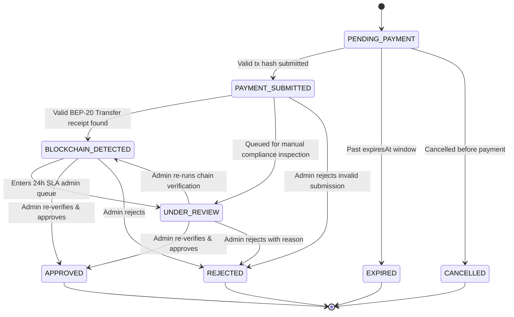

# BEP-20 USDT Deposit & Verification Lifecycle

## 1. End-to-End Sequence

```mermaid
sequenceDiagram
    actor User as Investor (apps/web)
    participant API as NestJS API (apps/api)
    participant Chain as Viem Verifier (packages/blockchain)
    participant DB as MySQL 8.0
    actor Admin as Admin / Master Admin (apps/admin)

    User->>API: POST /api/v1/deposits (100 USDT, BNB_SMART_CHAIN)
    API->>DB: Create DEP-YYYYMMDD-000001 (status = PENDING_PAYMENT)
    API-->>User: Return public BEP-20 receiving wallet + QR code (0 balance credited)

    Note over User: Sends BEP-20 USDT on BNB Smart Chain externally

    User->>API: POST /api/v1/deposits/:id/submit-payment (txHash + optional PNG/JPG proof)
    API->>API: Validate 66-char 0x hash (reject URLs) & verify image magic bytes
    API->>DB: Save unique payment_submissions row -> status = PAYMENT_SUBMITTED
    API->>Chain: verifyDepositTransaction(txHash, receivingWallet, usdtContract, amount)
    Chain-->>API: 9-step ERC-20 Transfer receipt result
    API->>DB: Upsert blockchain_transactions & transition -> BLOCKCHAIN_DETECTED -> UNDER_REVIEW
    API-->>User: "Your payment has been submitted and is under review. It may take up to 24 hours."

    Note over API,Admin: System NEVER auto-approves after 24 hours; manual admin action is mandatory

    Admin->>API: POST /api/v1/admin/deposits/:id/approve
    API->>Chain: Mandatory live re-verification of BEP-20 receipt right before approval
    Chain-->>API: Confirmed valid (authoritative on-chain tokenAmount)
    API->>DB: Row-lock deposit & wallet (SELECT ... FOR UPDATE)
    API->>DB: Insert immutable DEPOSIT LedgerEntry + activate INV-YYYYMMDD-000001 + AuditLog + Notification
    API-->>Admin: Deposit APPROVED & reconciled
```

---

## 2. Deposit State Transition Machine

Arbitrary transitions are rejected by `DepositStateService` (`INVALID_DEPOSIT_STATE_TRANSITION`):



