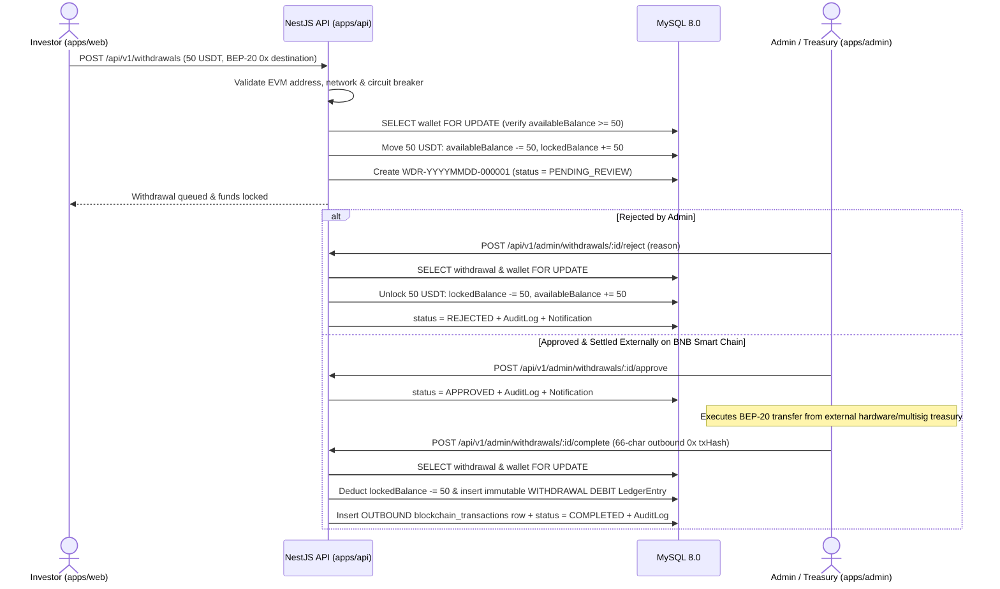
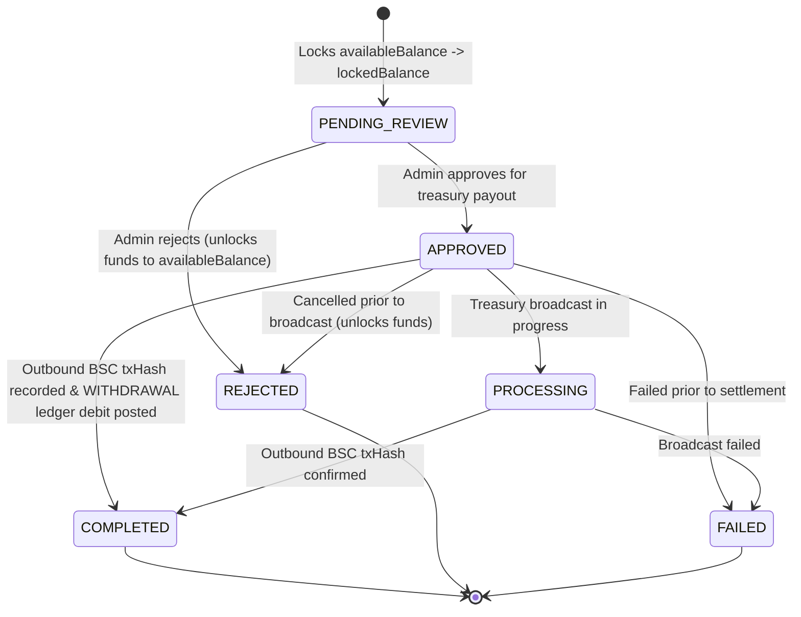

# Withdrawal Locking & Settlement Lifecycle

## 1. Segregated Wallet Buckets

Every user's MySQL `wallets` row maintains separate `DECIMAL(24, 8)` buckets:
- `availableBalance` — Liquid USDT eligible for immediate withdrawal (primarily credited yield/interest or unallocated funds). **Strictly enforced `>= 0` at all times.**
- `lockedBalance` — Funds atomically reserved while a withdrawal request is under review or awaiting outbound settlement.
- `investedBalance` — Principal actively allocated to `INV-...` positions.

---

## 2. End-to-End Withdrawal Sequence

---

## 3. Withdrawal State Transition Machine

